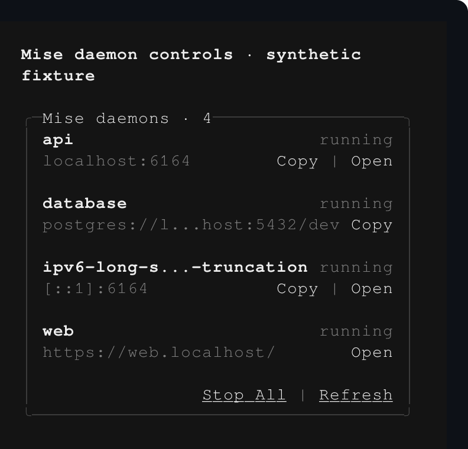

# Mise daemons

Show running [Mise daemons](https://mise.jdx.dev/daemons.html) for the current workspace in the OpenCode TUI sidebar. Open web URLs, copy endpoints, or stop the workspace's daemons.



Captured in OpenCode V2.3.0 with synthetic daemon data.

## Requirements

- OpenCode V2.3.0 or later.
- Mise with `mise daemons ls --json` support on the **OpenCode server's PATH**.
- Mise daemon prerequisites, including Pitchfork and experimental mode, configured as described in the [Mise daemon guide](https://mise.jdx.dev/daemons.html).

The plugin does not install tools, enable experimental mode, trust configuration, or start any daemons.

## Install

Add the Git target to the `plugins` array in `opencode.jsonc`:

```jsonc
{
  "$schema": "https://opencode.ai/config.json",
  "plugins": ["github:mholtzscher/opencode-plugins#main::path:mise-daemons"],
}
```

One entry loads both the server and TUI parts. The package includes its compiled TUI; no local build is needed. Configuration reloads automatically. Use `/reload` to force a reload.

For a local checkout, use its absolute path or a path relative to the configuration file, such as `"./mise-daemons"`. Load only one copy.

## Sidebar actions

Only daemons with Mise status `running` appear. Mise resolves inherited project configuration, shared references, environment profiles, and worktree namespaces. The plugin does not list unrelated Pitchfork projects.

| Mise output | Action |
| --- | --- |
| Absolute HTTP/HTTPS URL without embedded credentials | **Open** in the client's default browser |
| Another URL or endpoint | **Copy** the exact value |
| Bare `localhost:<port>`, `127.0.0.1:<port>`, or `[::1]:<port>` | **Copy** the endpoint, or explicitly **Open** using HTTP |
| Port without a URL | **Copy** `localhost:<port>`, or explicitly **Open** using HTTP |
| Neither a port nor a URL | **Copy** the daemon's full ID |

A port alone is not assumed to serve HTTP. **Open** is a separate action that opens `http://localhost:<port>` (or the reported loopback address) in your browser. The sidebar separates the actions as `Copy | Open`. It does not test whether the service speaks HTTP. Click the endpoint or **Copy** to keep copying the original value; the keyboard picker also keeps Copy first. Non-HTTP URIs such as `postgres://localhost:5432/db` remain copy-only.

Copying uses the terminal's OSC52 clipboard support; terminals that disable it may ignore the request.

Use the command palette:

- **Mise: Open or copy daemon** selects a running daemon and performs its labeled action.
- **Mise: Refresh daemons** refreshes the current workspace.

The sidebar refreshes every five seconds while mounted. Changing workspaces clears the previous workspace's results and cancels its pending requests. Failed refreshes label retained results **Stale** and disable their actions until a successful refresh.

### Stop workspace daemons

Click **Stop All** beside **Refresh**, then confirm the workspace path. This runs `mise --yes daemons stop` on the server in that workspace. Mise stops the daemons registered to its project, including those started by removed groups, and keeps their data. It does not stop unrelated projects or use a machine-wide `--all`.

Stop All is disabled while loading, empty, stale, or busy. Cancelling the dialog sends no stop request. The sidebar refreshes after the command, even on failure: a failed or interrupted stop may already have stopped some daemons. Start them again yourself using Mise.

## Empty and error states

The picker checks the selected daemon again before acting. If the daemon stopped or changed its endpoint while the picker was open, it performs no action. Select the daemon again to use a changed endpoint.

**No running daemons** means the lookup succeeded but none are running. **Mise not found** refers to the server PATH, not your terminal's PATH. An unsupported-command or invalid-data error can mean that Mise's experimental daemon interface changed. Run `mise daemons ls --json` in the same workspace on the server to diagnose it.

## Remote servers

Discovery and Stop All run on the OpenCode server. Browser and clipboard actions run on the TUI client. A `localhost` URL or copied endpoint still refers to the server's machine; this plugin does not create tunnels or rewrite addresses. Set up forwarding before opening remote localhost services.

See [Development](docs/DEVELOPMENT.md) for checks and live verification.
